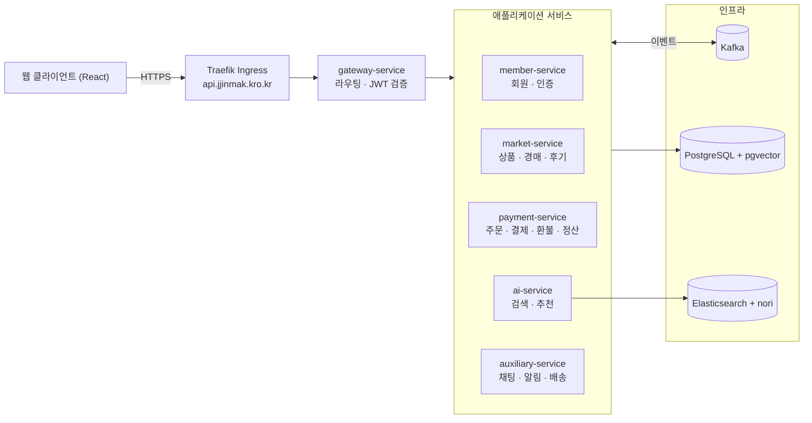

# 찐막 (jjinmak)

> 추억의 게임부터 희귀한 한정판까지, 사고팔고 경매하는 게임 전문 거래 플랫폼

같은 게임도 단종 · 미개봉 · 구성품 · 한정판 여부에 따라 가치가 크게 달라져, 판매자도 구매자도 적정 가격을 알기 어렵습니다. 찐막은 고전 게임기 · 게임팩 · 한정판을 경매로 사고팔아 입찰로 가격이 정해지게 하고, 낙찰 이후의 결제 · 배송 · 구매확정 · 정산까지 한 서비스 안에서 처리합니다.

- 서비스: https://jjinmak.kro.kr
- API 기본 주소: `https://api.jjinmak.kro.kr`
- 프론트엔드 저장소: [prgrms-be-adv-devcourse/beadv8_8_AHJB_FE](https://github.com/prgrms-be-adv-devcourse/beadv8_8_AHJB_FE)
- 프로그래머스 데브코스 백엔드 단기심화 8기 최종 프로젝트 (2026.09 ~ 2026.11)

## 팀원

| 이름 | 담당 | GitHub |
|---|---|---|
| 송현수 | 상품 등록 · 검색 | [@HyunSooooooooo](https://github.com/HyunSooooooooo) |
| 차승환 | 멤버 · 인프라 | [@greatCloud13](https://github.com/greatCloud13) |
| 박신형 | 경매 · 알림 | [@shinh09](https://github.com/shinh09) |
| 신종혁 | 주문 · 배송 · 추천 | [@Rasit-NP](https://github.com/Rasit-NP) |
| 김지유 | 결제 | [@AHFAH](https://github.com/AHFAH) |
| 조민형 | 채팅 · 환불 · 정산 | [@Pandarang](https://github.com/Pandarang) |

## 주요 기능

### 경매

- **영국식 경매**: 가격이 올라가고, 가장 높이 부른 사람이 낙찰됩니다. 판매자가 정한 즉시낙찰가로 바로 낙찰받을 수도 있습니다.
- **네덜란드식(하향식) 경매**: 가격이 내려가고, 가장 먼저 구매한 사람이 낙찰됩니다. 관리자가 등록합니다.
- **실시간 경매 상세**: 입찰이 들어오면 SSE로 화면에 바로 반영하고, 지금 보고 있는 사람 수를 보여 줍니다.
- **상품**: 상품 등록(이미지 업로드) · 수정 · 삭제, 경매 시작 전 상품 목록, 찜, 상품 Q&A
- **재등록**: 유찰되거나 미결제로 무효가 된 상품을 다음 회차 경매로 다시 올릴 수 있습니다.

### 낙찰 이후 거래

- **장바구니**: 낙찰된 상품이 결제 기한과 함께 장바구니에 담기고, 여러 상품을 한 번에 결제할 수 있습니다.
- **결제**: 예치금(토스페이먼츠로 충전), 카드 · 간편결제, 계좌이체 직접 결제를 지원하고, 포인트를 쓰거나 적립할 수 있습니다.
- **에스크로 정산**: 결제 대금은 구매확정 전까지 보관합니다. 구매확정되면 정산서를 만들고, 매일 03:00에 지급일이 된 정산 금액을 판매자 지갑으로 지급합니다.
- **배송 조회**: 판매자가 송장을 등록하면 Delivery Tracker로 배송 상태를 받아 주문 상태에 반영합니다.
- **구매확정 · 환불**: 구매자가 직접 구매확정하거나, 기한이 지나면 자동으로 확정됩니다. 환불 요청은 판매자가 수락하거나 거절하고, 기한 안에 발송되지 않은 주문은 자동으로 환불됩니다.
- **지갑**: 잔액 · 거래 내역 조회, 출금, 정산금 출금
- **후기**: 구매확정한 거래에 후기를 남깁니다.

### 소통

- **거래 채팅**: 낙찰되면 판매자와 구매자의 채팅방이 만들어집니다(WebSocket · STOMP). 계좌번호 · 전화번호 · 외부 메신저로 거래를 유도하는 메시지는 상대에게 전달되지 않습니다.
- **알림**: 상위 입찰 · 마감 임박 · 낙찰 · 유찰 · 결제 · 발송 · 배송 · 구매확정 · 환불 · 정산 알림을 보내고, FCM 웹 푸시와 수신 설정을 지원합니다.

### 검색 · 추천

- **검색**: Elasticsearch, nori 형태소 분석, 게임 용어 동의어 사전을 써서 "플스"로 검색해도 PS5 상품이 나옵니다.
- **추천**: 비슷한 경매, 인기 경매, 회원 맞춤 추천을 제공하고, 원하는 조건을 문장으로 적어 찾는 자연어 검색을 지원합니다.

### 회원

- 이메일 회원가입 · 로그인, 카카오 로그인, 토큰 재발급, 판매자 등록, 경고 내역 조회

## 기술 스택

| 분류 | 기술 |
|---|---|
| 언어 · 프레임워크 | Java 25, Spring Boot 4.1.1, Spring Data JPA, Spring Security, Spring Cloud Gateway(WebFlux) |
| 메시징 | Apache Kafka 4.3.2(KRaft), Spring Kafka |
| 데이터 | PostgreSQL 17 + pgvector, Flyway, Elasticsearch 9.4.5 + nori, Caffeine |
| 실시간 · 알림 | SSE, WebSocket · STOMP, Firebase Cloud Messaging |
| AI | Spring AI, OpenAI(text-embedding-3-large 임베딩, 채팅 모델) |
| 외부 연동 | 토스페이먼츠, Delivery Tracker, 카카오 로그인, AWS S3 |
| 인증 | JWT(jjwt, RS256) |
| 테스트 | JUnit 5, Mockito, Testcontainers(PostgreSQL, Kafka), H2, k6(부하 테스트) |
| 인프라 · 배포 | Docker, k3s, Traefik, cert-manager(Let's Encrypt), GitHub Actions, GitHub Container Registry |
| 모니터링 | Prometheus, Grafana, Alertmanager(Slack), Micrometer |
| 프론트엔드 | React, TypeScript, Vite, TanStack Query, Vercel |

## 아키텍처

### 시스템 구성



### 서비스 구성

처음에는 도메인마다 서비스를 나눠 13개로 운영했습니다. 서비스마다 JVM이 하나씩 떠서 앱 노드 메모리 사용률이 87~91%까지 오르자, 2026-11-17에 바운디드 컨텍스트는 그대로 두고 배포 단위만 6개로 합쳤습니다(통합 후 71%, 모니터링 포함). 게이트웨이는 통합 전 서비스 이름(`order-service`, `delivery-service` 등)으로 라우팅하고, Kubernetes Service 별칭이 그 이름을 통합된 서비스로 연결합니다.

| 서비스 | 포함 도메인 | 포트 | 외부 연동 |
|---|---|---|---|
| gateway-service | 라우팅, JWT 검증 | 8091 | |
| member-service | 회원, 인증, 제재 | 8083 | 카카오 로그인 |
| market-service | 상품, 경매, 후기 | 8086 | AWS S3(상품 이미지) |
| payment-service | 장바구니 · 주문, 결제 · 지갑, 환불, 정산 | 8085 | 토스페이먼츠 |
| ai-service | 검색, 추천 | 8084 | Elasticsearch, OpenAI |
| auxiliary-service | 거래 채팅, 알림, 배송 | 8087 | FCM, Delivery Tracker |

- 서비스마다 PostgreSQL 데이터베이스를 따로 쓰고, 스키마는 Flyway로 관리합니다.
- 서비스 안은 바운디드 컨텍스트별로 `in`(컨트롤러, Kafka 리스너, 스케줄러) / `app`(Facade, UseCase) / `domain`(엔티티) / `out`(저장소, 이벤트 발행, 외부 연동) 계층으로 나눕니다.

### 서비스 간 통신

- 배포 단위 사이에는 동기 호출 없이 Kafka 이벤트로만 데이터를 주고받습니다. 다른 서비스의 데이터가 필요하면 이벤트로 받아 자기 DB에 필요한 만큼 복사해 둡니다. 예를 들어 회원 가입 이벤트(`member.created`)를 받아 각 서비스가 회원 정보를 저장합니다.
- 이벤트와 DTO는 `libs/event-contracts`에 모아 둡니다. 서비스는 `libs/`만 의존하고 다른 서비스 모듈은 의존하지 않습니다.
- 주요 이벤트는 아웃박스로 발행합니다. 상태 변경과 이벤트를 같은 트랜잭션에 저장하고, 스케줄러가 1초마다 Kafka로 보냅니다.
- 처리에 실패한 메시지는 지수 백오프로 3번 다시 시도한 뒤 `<토픽>-dlt`로 옮깁니다.

경매 한 건이 낙찰되어 정산되기까지 오가는 주요 이벤트입니다.

| 단계 | 토픽 | 발행 | 받는 쪽에서 하는 일 |
|---|---|---|---|
| 상품 등록 · 수정 | `product.changed` | market | 검색 문서 갱신, 추천용 상품 정보 저장 (ai) |
| 입찰 | `auction.bid-succeed` | market | 추천 상호작용 기록 (ai), 상위 입찰 알림 (auxiliary) |
| 낙찰 | `auction.won` | market | 장바구니에 담기 (payment), 거래 채팅방 생성 · 낙찰 알림 (auxiliary), 검색 · 추천 상태 갱신 (ai) |
| 결제 완료 | `payment.payment-paid` → `order.payment-succeed` | payment | 주문 결제 완료 처리 (payment), 경매 상태 반영 (market), 결제 알림 (auxiliary) |
| 발송 | `order.send-product` | payment | 배송 추적 시작 · 발송 알림 (auxiliary) |
| 배송 상태 변경 | `delivery.status-updated` | auxiliary | 주문 배송 상태 반영 (payment), 배송 알림 (auxiliary) |
| 구매확정 | `order.confirm-purchase` | payment | 보관 대금 확정 · 정산서 생성 (payment), 경매 상태 반영 · 후기 작성 허용 (market), 알림 (auxiliary) |
| 정산 지급 (매일 03:00) | `settlement.requested` → `payment.payment-released` | payment | 판매자 지갑으로 지급 · 정산 완료 (payment), 정산 알림 (auxiliary) |

### 인증

1. 회원이 로그인하면 member-service가 RS256으로 서명한 액세스 토큰을 발급합니다.
2. gateway-service가 공개 키로 토큰을 검증하고, 회원 id와 권한을 `X-Member-Id`, `X-Member-Roles` 헤더에 넣어 서비스로 넘깁니다. 클라이언트가 보낸 같은 이름의 헤더는 지웁니다.
3. 각 서비스는 `libs/common`의 `HeaderAuthenticationFilter`로 이 헤더를 읽어 Spring Security 인증 정보를 만들고, 서비스별 보안 설정으로 접근을 제어합니다.

### 인프라 · 배포

| 노드 | 역할 | 올라가는 것 |
|---|---|---|
| large (k3s server) | 앱 · 운영 도구 | 앱 서비스 6개, Prometheus · Grafana · Alertmanager, cert-manager, Traefik · CoreDNS |
| medium (k3s agent) | 인프라 전용(taint) | PostgreSQL, Kafka, Elasticsearch, Kafka UI |

- 노드 메트릭을 모으는 node-exporter는 두 노드에 모두 올라갑니다.
- **CI**: PR이 열리면 `.github/scripts/changed-services.sh`가 변경 파일로 테스트할 서비스를 고르고, 그 서비스만 matrix로 나눠 병렬로 테스트합니다. `libs/`나 Gradle 설정이 바뀌면 모든 서비스를 테스트합니다.
- **CD**: `main`에 반영되면 같은 스크립트로 바뀐 서비스를 골라 이미지를 빌드해 GitHub Container Registry에 커밋 SHA 태그로 올리고, k3s의 self-hosted runner가 `k8s/app/<서비스>.yaml`을 적용합니다. 서비스 하나만 수동으로 배포할 수도 있습니다(workflow_dispatch).
- **모니터링**: kube-prometheus-stack으로 각 서비스의 `/actuator/prometheus`를 수집해 Grafana로 보고, Alertmanager가 Slack으로 알립니다.

## 프로젝트 구조

```text
.
├── libs/
│   ├── common              # 공통 응답(RsData), 예외 처리, JPA 기본 엔티티, 헤더 인증 필터
│   ├── common-kafka        # Kafka 메시지 변환, 재시도 · DLT 에러 처리
│   └── event-contracts     # 서비스 사이에 주고받는 이벤트 · DTO · 토픽 이름
├── services/
│   ├── gateway-service
│   ├── member-service
│   ├── market-service
│   ├── payment-service
│   ├── ai-service
│   └── auxiliary-service
├── k8s/                    # 앱 · 인프라 · 모니터링 매니페스트
├── infra/elasticsearch/    # nori 플러그인을 설치한 Elasticsearch 이미지
├── .github/                # CI · CD 워크플로, 이슈 · PR 템플릿
├── docker-compose.local.yaml   # 로컬 개발용 인프라
└── src/                    # MSA 전환 전 모듈러 모놀리스 (CI 테스트와 이미지 빌드 대상 아님)
```

## 로컬 실행

### 준비물

- JDK 25
- Docker(Compose 포함)

### 1. 인프라 실행

```bash
docker compose -f docker-compose.local.yaml up -d
```

| 구성 요소 | 주소 |
|---|---|
| PostgreSQL 17 + pgvector | `localhost:5432` (계정 `postgres` / `p@ssword`) |
| Kafka | `localhost:9092` |
| Kafka UI | http://localhost:8989 |
| Elasticsearch + nori | http://localhost:9200 |

Elasticsearch 이미지는 처음 실행할 때 `infra/elasticsearch/Dockerfile`로 빌드됩니다.

### 2. 데이터베이스 만들기 (처음 한 번)

Compose는 `embedding_db` 하나만 만들므로, 서비스가 쓰는 데이터베이스를 만듭니다. 테이블은 서비스가 뜰 때 Flyway가 만듭니다.

```bash
docker exec pgvector-db psql -U postgres -c "CREATE DATABASE member_db" -c "CREATE DATABASE market_module_db" -c "CREATE DATABASE payment_db" -c "CREATE DATABASE ai_db" -c "CREATE DATABASE auxiliary_module_db"
```

### 3. 서비스 실행

서비스마다 터미널을 하나씩 열어 `local` 프로필로 실행합니다. IntelliJ에서는 실행 구성의 Active profiles에 `local`을 넣습니다. payment-service는 토스페이먼츠 시크릿 키가 없으면 뜨지 않으므로 `TOSS_PAYMENTS_SECRET_KEY`를 함께 넘깁니다.

```bash
./gradlew :services:member-service:bootRun --args='--spring.profiles.active=local'
```

```bash
./gradlew :services:market-service:bootRun --args='--spring.profiles.active=local'
```

```bash
TOSS_PAYMENTS_SECRET_KEY=<토스페이먼츠 시크릿 키> ./gradlew :services:payment-service:bootRun --args='--spring.profiles.active=local'
```

```bash
./gradlew :services:ai-service:bootRun --args='--spring.profiles.active=local'
```

```bash
./gradlew :services:auxiliary-service:bootRun --args='--spring.profiles.active=local'
```

| 서비스 | 포트 | Swagger UI |
|---|---|---|
| member-service | 8083 | http://localhost:8083/swagger-ui/index.html |
| market-service | 8086 | http://localhost:8086/swagger-ui/index.html |
| payment-service | 8085 | http://localhost:8085/swagger-ui/index.html |
| ai-service | 8084 | http://localhost:8084/swagger-ui/index.html |
| auxiliary-service | 8087 | http://localhost:8087/swagger-ui/index.html |

API를 바로 확인할 때는 서비스 포트로 직접 호출할 수 있습니다. 인증이 필요한 API는 게이트웨이가 넣어 주는 헤더(`X-Member-Id`: 회원 id, `X-Member-Roles`: 권한을 쉼표로 구분)를 직접 넣습니다.

```bash
curl -H 'X-Member-Id: 1' http://localhost:8087/api/v1/notifications
```

### 외부 연동 키

| 환경 변수 | 서비스 | 용도 | 없을 때 |
|---|---|---|---|
| `TOSS_PAYMENTS_SECRET_KEY` | payment-service | 토스페이먼츠 결제 승인 · 취소 | 서비스가 뜨지 않음 |
| `OPENAI_API_KEY` | ai-service | 상품 임베딩, 자연어 검색 | 서비스는 뜨고 해당 기능만 실패 |
| `DELIVERY_TRACKER_CLIENT_ID`, `DELIVERY_TRACKER_CLIENT_SECRET` | auxiliary-service | 배송 조회 | 서비스는 뜨고 해당 기능만 실패 |
| `FCM_ENABLED`, `FCM_CREDENTIALS_BASE64` | auxiliary-service | 웹 푸시 | 웹 푸시를 보내지 않음(기본값 `false`) |
| `KAKAO_CLIENT_ID`, `KAKAO_CLIENT_SECRET` | member-service | 카카오 로그인 | 서비스는 뜨고 카카오 로그인만 실패 |

- auxiliary-service는 `local` 프로필에서 저장소 루트의 `.env`도 읽으므로, Delivery Tracker와 FCM 키는 `.env`에 넣어도 됩니다. `.env`는 git에 올라가지 않습니다.
- market-service는 `local` 프로필에서 상품 이미지를 S3 대신 로컬에 저장하므로 AWS 설정이 필요 없습니다.

### 테스트

```bash
./gradlew :services:payment-service:test
```

테스트는 서비스별로 실행합니다. PostgreSQL · Kafka가 필요한 테스트는 Testcontainers로 컨테이너를 띄우므로 Docker가 켜져 있어야 합니다. CI도 PR에서 바뀐 서비스마다 같은 명령을 실행합니다.

## 협업 방식

- 기본 브랜치는 `develop`입니다. 이슈 템플릿(기능 · 버그 · 리팩토링)으로 이슈를 만들고, 작업 브랜치에서 PR 템플릿에 맞춰 PR을 올립니다.
- PR은 CI(바뀐 서비스의 테스트)를 통과하면 `develop`에 squash 병합합니다.
- 배포할 때는 `develop`을 `main`에 병합하고, CD가 바뀐 서비스만 배포합니다.
- 커밋 메시지는 `feat:`, `fix:`, `refactor:` 같은 접두어로 시작합니다.
